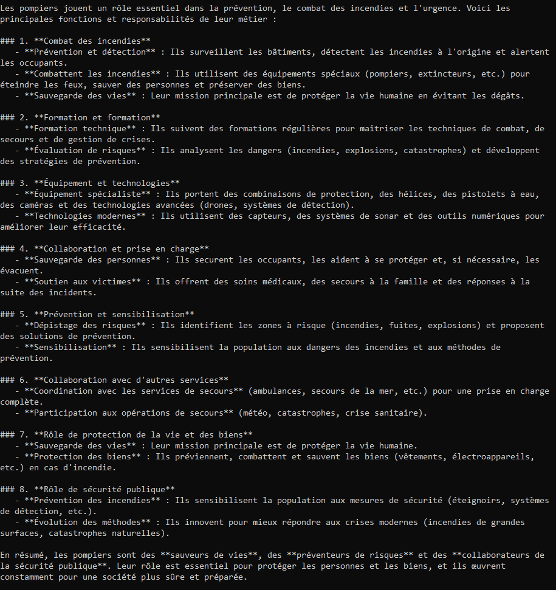
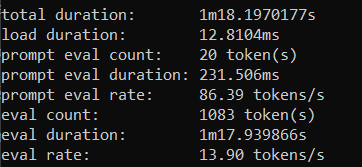
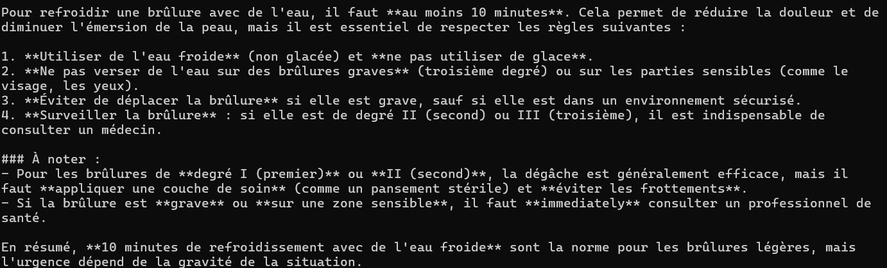
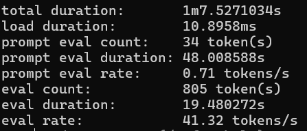

# Qwen3 1.7B (Ollama)

# Premier test

**Ce premier test sera le même pour chaque modèle testé, 2 questions, une générale et une précise ensuite je poserais les 40 questions et récupererais les résultats via un programme**

Pour commencer les premiers tests avec le modèle j'ai simplement posée des questions "classique" concernant les pompiers comme leurs rôles/ leurs lieu de travail etc

En utilisant --verbose en lançant le modèle ça m'a permis d'avoir des détails comme le temps que le modèle prend pour me répondre 

Voici les premiers résultats:

### Question générale

Pour la question: "Quel est le rôle des pompiers?"

On voit que le modèle m'a généré une réponse complète mais beaucoup trop complète après la question était générale donc j'attend de voir concernant une question sur une demande précise.

### Question précise

Pour la question: "Pendant combien de temps on a besoin pour refroidir une brûlure avec de l’eau ?"

On voit que le modèle m'a généré une réponse beaucoup plus courte que la question d'avant, ce qui est bien mais le modèle a mis au moins une quinzaine de seconde avant de commencer à me répondre.

